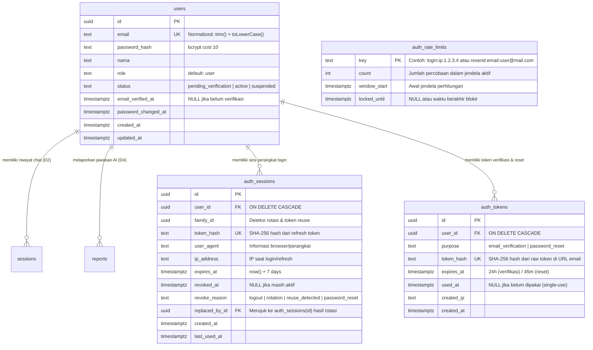
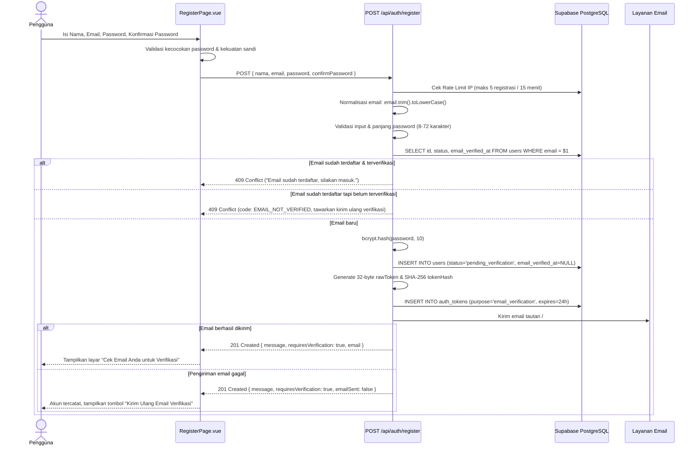
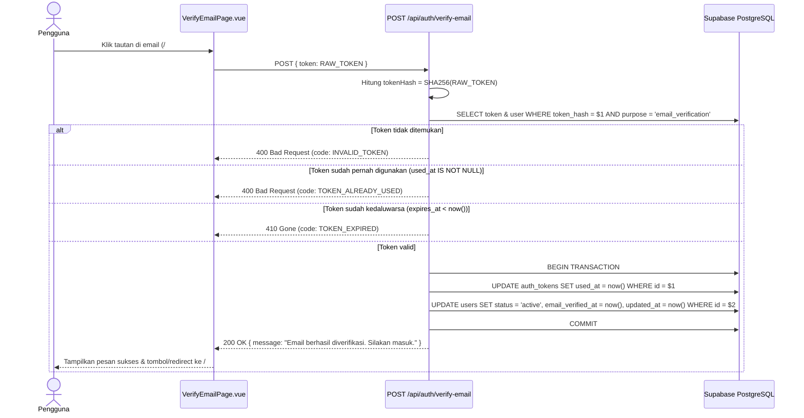
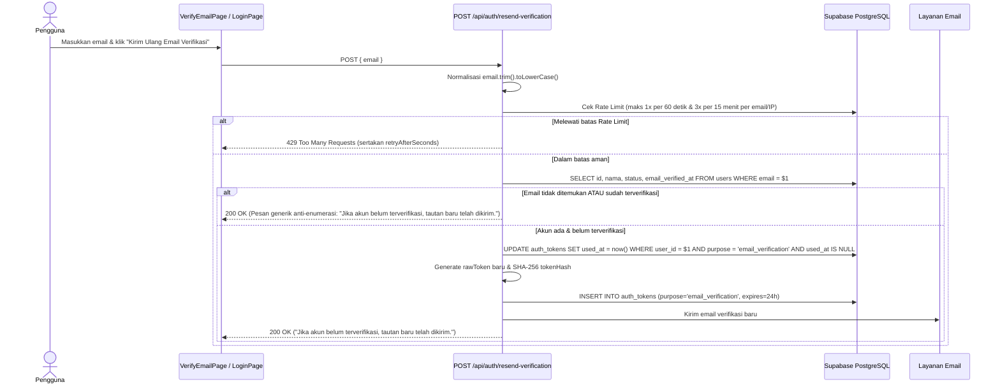
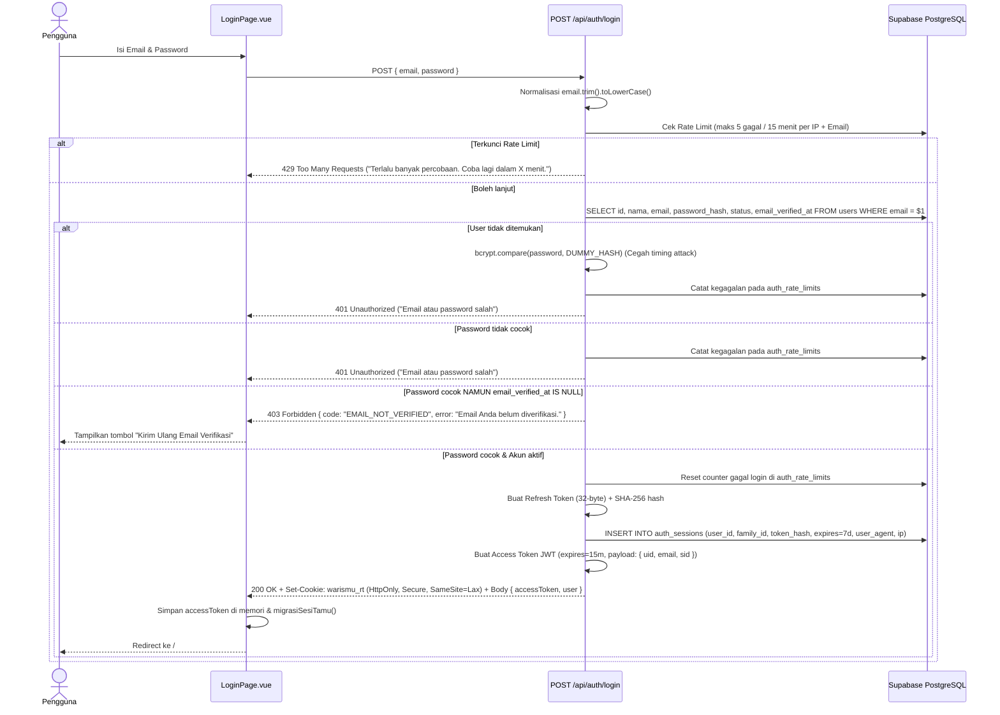
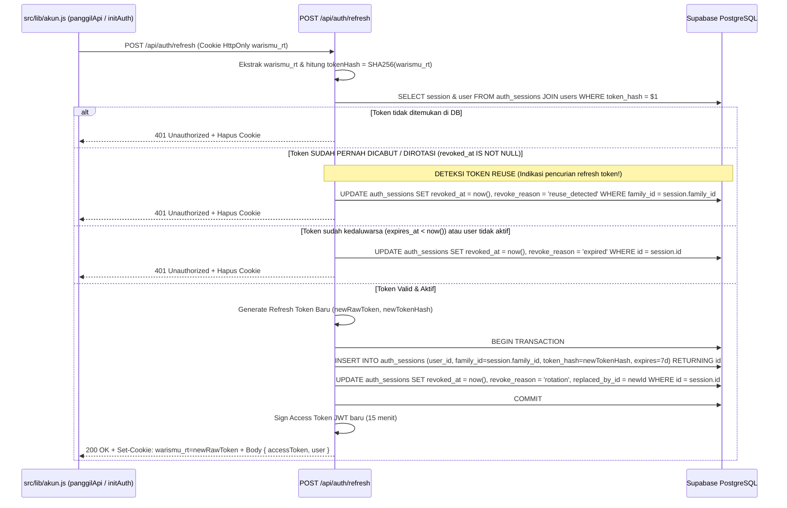
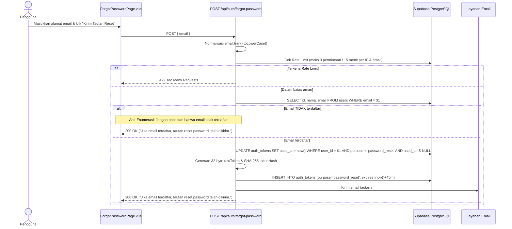
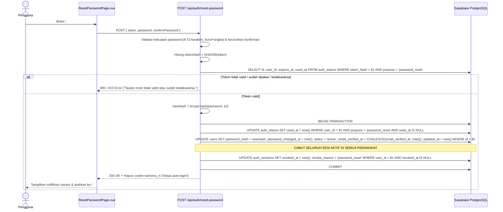
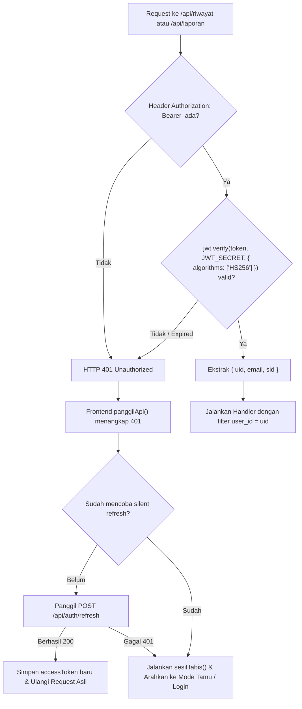

# Rancangan Arsitektur Autentikasi WarisMu

- **Proyek:** WarisMu — Asisten Edukasi & Simulasi Waris Islam (Faraid)
- **Target Stack:** Vue 3 + Vite (SPA Hash Router), Node.js ESM Serverless Functions (Vercel), Supabase PostgreSQL (`pg` Pooler Port 6543)
- **Status Dokumen:** Rancangan Arsitektur Final (Menunggu Persetujuan Implementasi)

---

## 1. Prinsip Desain & Kepatuhan terhadap Arsitektur WarisMu

Rancangan ini disusun dengan mematuhi seluruh batasan proyek WarisMu:
1. **Tidak Mengubah Fitur Inti yang Sudah Berjalan:**
   - Tabel `sessions` (D2) tetap digunakan eksklusif untuk **riwayat sesi konsultasi chat** (`api/riwayat.js`).
   - Endpoint `POST /api/chat` dan `KalkulatorPage.vue` tetap dapat diakses tanpa login (**Mode Tamu / Guest Mode**).
   - Fitur migrasi sesi chat tamu (`migrasiSesiTamu()` di `src/lib/akun.js`) tetap dipertahankan dan disesuaikan agar berjalan saat pengguna berhasil login pertama kali setelah verifikasi email.
2. **Keamanan Standar Industri (Zero Trust Token Management):**
   -Seluruh token sensitif sekali pakai (verifikasi email, reset password) dan refresh token **tidak pernah disimpan dalam bentuk plaintext di database**, melainkan di-hash menggunakan **SHA-256 (`crypto.createHash('sha256')`)**.
   - **Access Token (JWT, 15 menit)** disimpan di memori aplikasi frontend (variabel reaktif di `src/lib/akun.js`, bukan di `localStorage`) atau disegarkan otomatis saat tab dimuat ulang (*silent refresh*).
   - **Refresh Token (Opaque 256-bit token, 7 hari)** disimpan di cookie browser dengan atribut **`HttpOnly; Secure; SameSite=Lax; Path=/api/auth`**.
3. **Biaya Operasional Nol / Sangat Rendah (Zero Extra Infrastructure Cost):**
   - Tidak memerlukan Redis berbayar untuk *session store* maupun *rate limiting*; seluruh pengelolaan sesi, rotasi refresh token, dan *sliding-window rate limiting* memanfaatkan **Supabase PostgreSQL** yang sudah digunakan proyek.
   - Pengiriman email menggunakan panggilan HTTP `fetch` murni (tanpa SDK berat) ke layanan transactional email gratis/hemat biaya (Resend REST API atau SMTP Brevo/Gmail App Password fallback).

---

## 2. Strategi Token, Sesi, Cookie, CSRF, dan CORS

### 2.1. Evaluasi Masa Berlaku Token (TTL)

| Jenis Token | Usulan Awal | Rekomendasi Final | Alasan Teknis & Evaluasi Kondisi Aplikasi WarisMu |
|---|---|---|---|
| **Access Token (JWT)** | 15 menit | **15 menit (`900s`)** | Sangat ideal. Sesi konsultasi faraid rata-rata berlangsung 5–20 menit. Jika akun dicabut/reset password, jendela akses maksimum token lama hanya 15 menit, sementara pengguna aktif tidak terganggu karena `panggilApi()` melakukan *silent refresh* otomatis. |
| **Refresh Token** | 7 hari | **7 hari (`604800s`)** | Seimbang antara kenyamanan keluarga yang kembali berkonsultasi di akhir pekan berikutnya dan keamanan perangkat bersama. Setiap kali dipakai, token dirotasi (*Refresh Token Rotation*). |
| **Token Verifikasi Email** | 24 jam | **24 jam (`86400s`)** | Memberi waktu cukup bagi pengguna yang tidak langsung membuka kotak masuk email, sambil membatasi umur tautan yang belum terpakai. |
| **Token Reset Password** | 30–60 menit | **45 menit (`2700s`)** | Titik tengah optimal dari rentang 30–60 menit: cukup longgar bila ada jeda pengiriman email 1–3 menit, namun cukup singkat untuk meminimalkan risiko penyalahgunaan tautan reset. |

### 2.2. Penyimpanan Token & Keamanan Cookie
1. **Access Token (JWT HS256):**
   - Payload: `{ sub: user.id, uid: user.id, email: user.email, sid: session.id, iat, exp }`.
   - Disimpan di **memori JavaScript (`let accessTokenMemori = ''` di `src/lib/akun.js`)**, **BUKAN di `localStorage`**.
   - Saat halaman di-refresh (`F5`), frontend memanggil `POST /api/auth/refresh` (yang otomatis menyertakan cookie `HttpOnly` refresh token) untuk mendapatkan access token baru dan data profil `user`.
2. **Refresh Token (Opaque 32-byte random hex / base64url):**
   - Dikirim oleh server melalui header `Set-Cookie`:
     ```http
     Set-Cookie: warismu_rt=<RAW_TOKEN>; HttpOnly; Secure; SameSite=Lax; Path=/api/auth; Max-Age=604800
     ```
   - *Catatan Development Lokal (`http://localhost:5173`):* Atribut `Secure` diaktifkan otomatis saat `process.env.NODE_ENV === 'production'` atau `req.headers['x-forwarded-proto'] === 'https'`, sehingga tetap bekerja saat pengujian di `vite dev` (`http://localhost`).
   - Pembatasan `Path=/api/auth` memastikan browser **hanya** mengirimkan cookie refresh token saat memanggil `/api/auth/refresh` atau `/api/auth/logout`, dan tidak membebani request `/api/chat` atau `/api/riwayat`.

### 2.3. Perlindungan CSRF dan CORS
- Karena frontend Vue 3 dan backend `api/` di-deploy pada **satu origin yang sama di Vercel** (misalnya `https://warismu.vercel.app` dan `/api/...`):
  1. **CORS:** Tidak perlu membuka `Access-Control-Allow-Origin: *` pada endpoint `/api/auth/*`. Semua request adalah *Same-Origin*.
  2. **CSRF:**
     - Seluruh endpoint `/api/auth/*` yang mengubah state hanya menerima metode `POST` dengan header `Content-Type: application/json`. Browser secara native memblokir pengiriman lintas-situs (`cross-origin`) dengan `Content-Type: application/json` tanpa *preflight* CORS.
     - Cookie menggunakan `SameSite=Lax` (atau `Strict`).
     - Tambahan lapisan keamanan (*Defense-in-Depth*): Middleware memeriksa header `Origin` / `Referer` pada setiap request `POST /api/auth/refresh` dan `POST /api/auth/logout` agar sesuai dengan host aplikasi (`APP_BASE_URL` atau `req.headers.host`).

---

## 3. Rancangan Perubahan Struktur Database (PostgreSQL)

Untuk menjaga kompatibilitas 100% dengan `db/schema.sql` saat ini (tabel D1–D5), kita menambahkan kolom baru pada `users` secara non-destruktif (`ALTER TABLE ... ADD COLUMN IF NOT EXISTS`) dan menambahkan 3 tabel khusus autentikasi (`auth_sessions`, `auth_tokens`, `auth_rate_limits`).

### 3.1. Diagram Entity-Relationship (ERD)



### 3.2. Spesifikasi DDL SQL Baru

```sql
-- ============================================================================
-- MIGRASI AUTENTIKASI WARISMU (NON-DESTRUCTIVE)
-- ============================================================================

-- 1. Perluasan Tabel D1: users
ALTER TABLE users
  ADD COLUMN IF NOT EXISTS status TEXT NOT NULL DEFAULT 'pending_verification',
  ADD COLUMN IF NOT EXISTS email_verified_at TIMESTAMPTZ,
  ADD COLUMN IF NOT EXISTS password_changed_at TIMESTAMPTZ;

-- Catatan Migrasi Akun Lama:
-- Akun yang sudah terdaftar sebelum fitur verifikasi email diterapkan dapat ditandai
-- aktif agar pengguna lama tidak terkunci (opsional, lihat AUTH_IMPLEMENTATION_PLAN.md).

CREATE INDEX IF NOT EXISTS idx_users_email_lower ON users (lower(email));
CREATE INDEX IF NOT EXISTS idx_users_status ON users (status);

-- 2. Tabel Sesi Perangkat & Refresh Token (auth_sessions)
CREATE TABLE IF NOT EXISTS auth_sessions (
  id UUID PRIMARY KEY DEFAULT gen_random_uuid(),
  user_id UUID NOT NULL REFERENCES users(id) ON DELETE CASCADE,
  family_id UUID NOT NULL DEFAULT gen_random_uuid(),
  token_hash TEXT UNIQUE NOT NULL,
  user_agent TEXT,
  ip_address TEXT,
  expires_at TIMESTAMPTZ NOT NULL,
  revoked_at TIMESTAMPTZ,
  revoke_reason TEXT,
  replaced_by_id UUID REFERENCES auth_sessions(id) ON DELETE SET NULL,
  created_at TIMESTAMPTZ NOT NULL DEFAULT now(),
  last_used_at TIMESTAMPTZ NOT NULL DEFAULT now()
);

CREATE INDEX IF NOT EXISTS idx_auth_sessions_user_id ON auth_sessions (user_id);
CREATE INDEX IF NOT EXISTS idx_auth_sessions_family_id ON auth_sessions (family_id);
CREATE INDEX IF NOT EXISTS idx_auth_sessions_expires_at ON auth_sessions (expires_at);

-- 3. Tabel Token Sekali Pakai: Verifikasi Email & Reset Password (auth_tokens)
CREATE TABLE IF NOT EXISTS auth_tokens (
  id UUID PRIMARY KEY DEFAULT gen_random_uuid(),
  user_id UUID NOT NULL REFERENCES users(id) ON DELETE CASCADE,
  purpose TEXT NOT NULL CHECK (purpose IN ('email_verification', 'password_reset')),
  token_hash TEXT UNIQUE NOT NULL,
  expires_at TIMESTAMPTZ NOT NULL,
  used_at TIMESTAMPTZ,
  created_ip TEXT,
  created_at TIMESTAMPTZ NOT NULL DEFAULT now()
);

CREATE INDEX IF NOT EXISTS idx_auth_tokens_user_purpose ON auth_tokens (user_id, purpose);
CREATE INDEX IF NOT EXISTS idx_auth_tokens_expires_at ON auth_tokens (expires_at);

-- 4. Tabel Rate Limiting Serverless (auth_rate_limits)
CREATE TABLE IF NOT EXISTS auth_rate_limits (
  key TEXT PRIMARY KEY,
  count INT NOT NULL DEFAULT 1,
  window_start TIMESTAMPTZ NOT NULL DEFAULT now(),
  locked_until TIMESTAMPTZ
);

CREATE INDEX IF NOT EXISTS idx_auth_rate_limits_window ON auth_rate_limits (window_start);
```

### 3.3. Kebijakan Penyimpanan, Pembatalan, dan Penghapusan Token (Housekeeping)
1. **Penyimpanan Hanya Hash:** Token mentah (`rawToken = crypto.randomBytes(32).toString('hex')`) hanya dikirim ke email pengguna atau cookie `HttpOnly`. Database hanya menyimpan `crypto.createHash('sha256').update(rawToken).digest('hex')`.
2. **Invalidasi Token Lama Saat Terbit Baru:**
   - Saat pengguna meminta kirim ulang email verifikasi, seluruh token `email_verification` milik `user_id` tersebut yang belum terpakai (`used_at IS NULL`) langsung di-update menjadi `used_at = now()` sebelum token baru dibuat.
   - Saat pengguna meminta reset password baru, seluruh token `password_reset` milik `user_id` tersebut yang belum terpakai langsung di-update menjadi `used_at = now()`.
3. **Opportunistic Cleanup (Pembersihan Otomatis Tanpa Cron Berbayar):**
   - Pada operasi tulis autentikasi, server dapat menjalankan kueri pembersihan ringan secara asinkron (*fire-and-forget*):
     - Menghapus baris `auth_tokens` yang sudah kedaluwarsa lebih dari 7 hari (`expires_at < now() - interval '7 days'`).
     - Menghapus baris `auth_sessions` yang sudah kedaluwarsa atau dicabut lebih dari 30 hari.
     - Menghapus baris `auth_rate_limits` yang `window_start < now() - interval '1 day'`.

---

## 4. Diagram Alur 12 Proses Autentikasi

### 4.1. Alur 1: Registrasi (`POST /api/auth/register`)



### 4.2. Alur 2: Verifikasi Email (`POST /api/auth/verify-email`)



### 4.3. Alur 3: Pengiriman Ulang Verifikasi (`POST /api/auth/resend-verification`)



### 4.4. Alur 4: Login (`POST /api/auth/login`)



### 4.5. Alur 5: Logout (`POST /api/auth/logout`)

```mermaid
sequenceDiagram
    actor User as Pengguna
    participant UI as Navbar / ChatSidebar
    participant API as POST /api/auth/logout
    participant DB as Supabase PostgreSQL

    User->>UI: Klik tombol "Keluar"
    UI->>API: POST /api/auth/logout (Cookie warismu_rt terkirim otomatis)
    API->>API: Baca cookie warismu_rt & hitung SHA-256 tokenHash
    alt Cookie ada
        API->>DB: UPDATE auth_sessions SET revoked_at = now(), revoke_reason = 'logout' WHERE token_hash = $1
    end
    API-->>UI: 200 OK + Set-Cookie: warismu_rt=; Max-Age=0 (Hapus cookie)
    UI->>UI: Bersihkan accessToken di memori & profil pengguna
    UI-->>User: Kembali ke Beranda (/#/)
```

### 4.6. Alur 6 & 7: Refresh Access Token & Rotasi Refresh Token (`POST /api/auth/refresh`)



### 4.7. Alur 8: Lupa Password (`POST /api/auth/forgot-password`)



### 4.8. Alur 9 & 10: Reset Password & Pencabutan Seluruh Sesi (`POST /api/auth/reset-password`)



### 4.9. Alur 11: Perlindungan Endpoint API (`/api/riwayat` & `/api/laporan`)



---

## 5. Rancangan Integrasi Layanan Email Transaksional

### 5.1. Evaluasi & Rekomendasi Provider Email untuk WarisMu

Karena WarisMu di-deploy di **Vercel Serverless Functions**, layanan pengiriman email harus:
- Dapat dipanggil melalui **HTTPS REST API (`fetch` murni)** tanpa bergantung pada koneksi TCP SMTP port 25/465 yang sering diblokir atau lambat (*cold-start*) di lingkungan serverless.
- Memiliki paket gratis (*free tier*) yang memadai untuk kebutuhan akademik, demo, dan produksi skala awal.

| Kriteria | **Opsi 1: Resend (DIREKOMENDASIKAN UTAMA)** | **Opsi 2: Brevo (Sendinblue) HTTP API (REKOMENDASI ALTERNATIF)** |
|---|---|---|
| **Kuota Gratis** | **3.000 email / bulan** (100 email / hari) — Gratis selamanya | **300 email / hari** (~9.000 email / bulan) — Gratis selamanya |
| **Metode Integrasi** | `fetch('https://api.resend.com/emails', ...)` — **0 dependensi npm tambahan** | `fetch('https://api.brevo.com/v3/smtp/email', ...)` — **0 dependensi npm tambahan** |
| **Kesesuaian Vercel** | Sangat tinggi (dirancang khusus untuk serverless, respons < 300 ms) | Tinggi (REST API JSON standar) |
| **Syarat Domain** | Memerlukan verifikasi DNS domain kustom untuk kirim ke sembarang email; tanpa domain kustom hanya bisa mengirim ke email pemilik akun. | **Dapat mengirim ke alamat email mana pun** (Gmail/Yahoo/Outlook pengguna) hanya dengan memverifikasi 1 alamat email pengirim (*Single Sender Verification*), tanpa wajib membeli domain kustom! |

> **Rekomendasi Arsitektur Adapter (`api/lib/mailer.js`):**
> Gunakan pola *provider-agnostic HTTP mailer* di `api/lib/mailer.js` yang mendukung:
> 1. **`EMAIL_PROVIDER=brevo`** (Sangat cocok jika WarisMu masih menggunakan domain `.vercel.app` dan belum membeli domain kustom, karena Brevo mengizinkan pengiriman ke email pengguna mana pun dengan *verified sender email* gratis).
> 2. **`EMAIL_PROVIDER=resend`** (Sangat cocok jika WarisMu sudah memiliki domain kustom yang diverifikasi DNS-nya).
> 3. **`EMAIL_PROVIDER=console` (Dev Mode Fallback):** Saat berjalan di lokal (`npm run dev`) dan API key email belum diisi, tautan verifikasi/reset dicetak dengan jelas di terminal server lokal agar pengembang tetap dapat menguji alur end-to-end tanpa hambatan.

### 5.2. Konfigurasi Environment Variable Baru (`.env.example`)

Tambahkan variabel berikut ke `.env.example` (tanpa menyertakan secret asli):
```dotenv
# ---- Konfigurasi Autentikasi & Sesi ----
JWT_SECRET=ganti-dengan-string-acak-minimal-32-karakter
JWT_ACCESS_EXPIRES_IN=15m
REFRESH_TOKEN_TTL_DAYS=7
EMAIL_VERIFY_TTL_HOURS=24
PASSWORD_RESET_TTL_MINUTES=45

# URL publik aplikasi untuk menyusun tautan di dalam email (tanpa garis miring di akhir)
APP_BASE_URL=http://localhost:5173

# ---- Layanan Email Transaksional (pilih: brevo | resend | console) ----
EMAIL_PROVIDER=brevo
EMAIL_FROM_NAME=WarisMu — Asisten Waris Islam
EMAIL_FROM_ADDRESS=no-reply@domain-anda.com

# Jika memakai Brevo (https://app.brevo.com/settings/keys/api)
BREVO_API_KEY=

# Jika memakai Resend (https://resend.com/api-keys)
RESEND_API_KEY=
```

### 5.3. Format URL di Dalam Email (Kompatibilitas Vue Router Hash History)
Karena `src/router/index.js` menggunakan `createWebHashHistory()`, seluruh tautan yang dikirim ke email pengguna **wajib menggunakan prefix `/#/`**:
- **Tautan Verifikasi Email:** `${APP_BASE_URL}/#/verifikasi-email?token=${encodeURIComponent(rawToken)}`
- **Tautan Reset Password:** `${APP_BASE_URL}/#/reset-password?token=${encodeURIComponent(rawToken)}`

### 5.4. Penanganan Kegagalan Pengiriman Email (Graceful Error Handling)
1. **Saat Registrasi (`POST /api/auth/register`):**
   - Jika `INSERT INTO users` dan `INSERT INTO auth_tokens` sudah berhasil tetapi panggilan HTTP ke provider email gagal/timeout (mis. gangguan jaringan eksternal):
   - Akun **tetap tersimpan** dengan status `pending_verification` (tidak membuat akun gagal terdaftar atau inkonsisten).
   - API mengembalikan HTTP `201 Created` dengan flag `emailSent: false` dan pesan: *"Akun berhasil dibuat, namun pengiriman email verifikasi mengalami kendala. Silakan klik tombol Kirim Ulang Email Verifikasi."*
2. **Saat Pengiriman Ulang Verifikasi / Lupa Password:**
   - Jika provider email gagal merespons dalam batas timeout (8 detik), kembalikan HTTP `503 Service Unavailable` dengan pesan ramah: *"Layanan pengiriman email sedang sibuk. Silakan coba lagi dalam beberapa saat."* tanpa membocorkan detail teknis atau stack trace.
